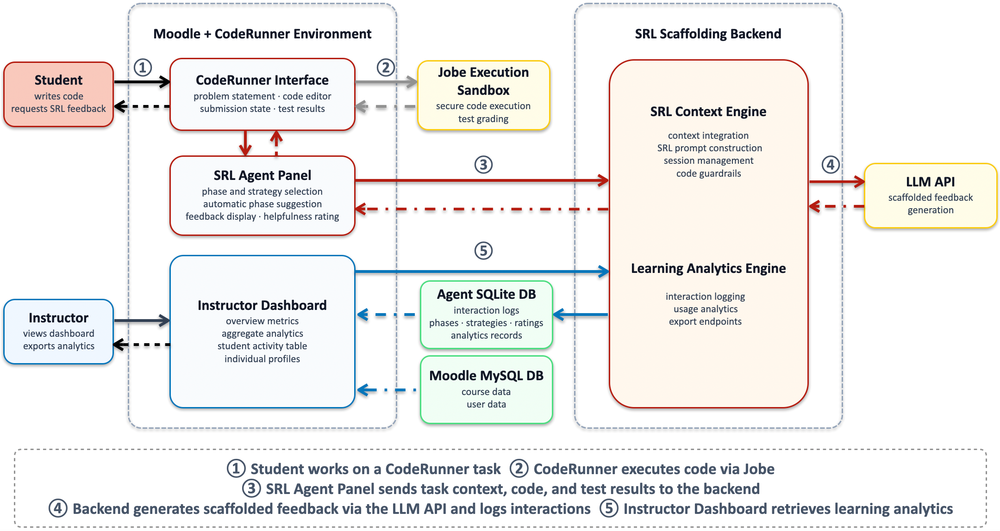
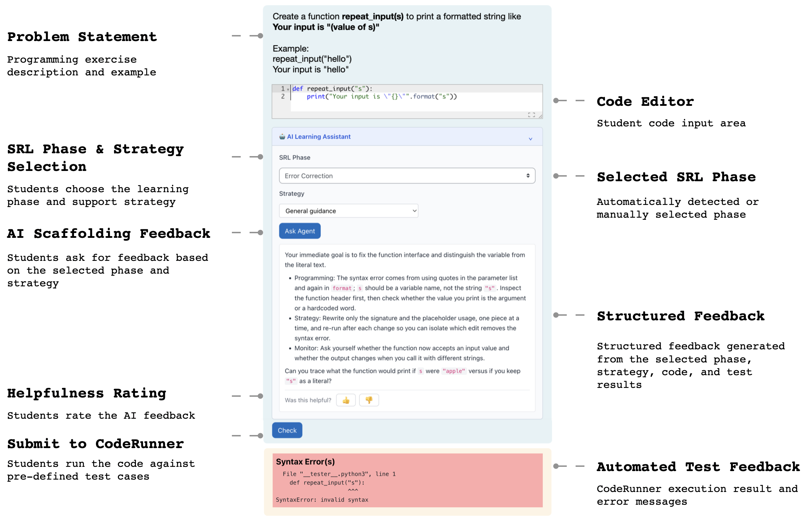
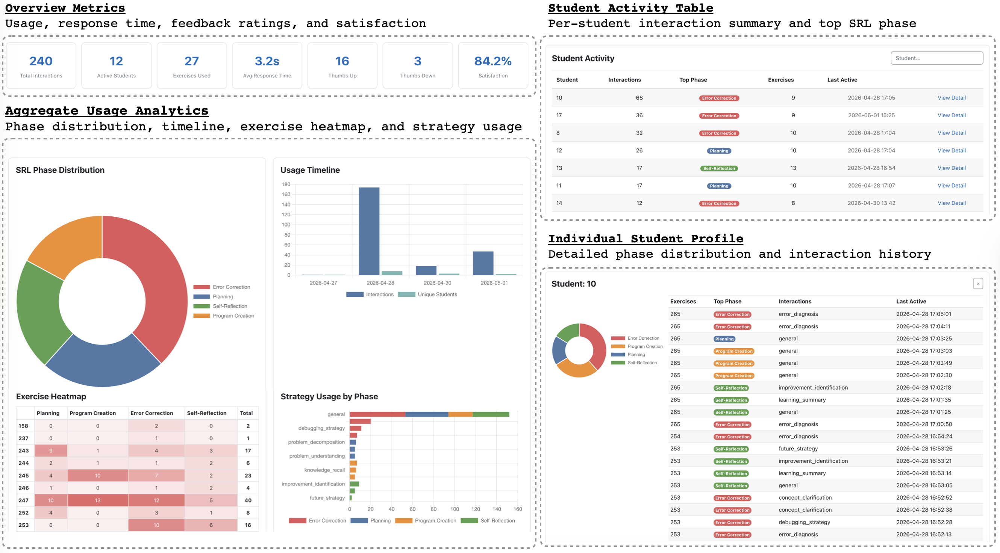

# CodeRunner Agent

> Open-source, LLM-powered Self-Regulated Learning (SRL) scaffolding for the Moodle CodeRunner plugin.

## Abstract

Large Language Models (LLMs) have created new opportunities for scalable programming
support, but many existing tools prioritize direct coding assistance and remain external
to institutional learning environments. These limitations make it difficult to provide
context-aware feedback, cultivate Self-Regulated Learning (SRL), and give instructors
visibility into how students interact with AI assistance. CodeRunner Agent is an
open-source, LLM-powered SRL scaffolding system integrated with the Moodle
[CodeRunner](https://github.com/trampgeek/moodle-qtype_coderunner) plugin. It combines
an embedded student support panel, SRL-oriented AI scaffolding, automatic SRL phase
detection, code guardrails, and an instructor dashboard for real-time learning analytics.
The student interface supports four operational phases: **Planning**, **Program
Creation**, **Error Correction**, and **Self-Reflection**.

## Architecture

CodeRunner Agent augments a standard Moodle + CodeRunner + Jobe stack with an LLM-backed
Agent API and a student-facing SRL panel.



## Highlights

- **Embedded student support panel** beside every CodeRunner question.
- **SRL-oriented AI scaffolding** that gives hint-based, context-aware feedback instead of complete solutions.
- **Automatic SRL phase detection** from the student's code and submission state.
- **Code guardrails** that keep responses pedagogical and on-task.
- **Instructor dashboard** for real-time learning analytics across SRL phases.

## Student Agent Panel

The SRL panel appears alongside each CodeRunner question; students pick a phase and
strategy and receive scaffolded LLM feedback on their own code and test results.



## Instructor Dashboard

Instructors get real-time analytics on student interactions: SRL phase distribution,
usage timeline, exercise heatmap, strategy breakdown, satisfaction ratings, and
per-student drill-down.



## Quick Start

**Prerequisites:** Docker & Docker Compose, Git, Python 3, and an OpenAI API key.

```bash
# 1. Clone
git clone https://github.com/open-aied/coderunner-agent.git
cd coderunner-agent

# 2. Configure — copy the template and edit it with YOUR values
cp .env.example .env
# Open .env and set your own values. At minimum set OPENAI_API_KEY.
# For any non-localhost use, also set MOODLE_ADMIN_PASSWORD and the MySQL passwords.

# 3. Run
./setup.sh
```

`setup.sh` clones Moodle 4.5 and CodeRunner, applies the agent panel patch, and starts
all containers. After startup (~3-5 min for Moodle initialization):

- **Moodle**: http://localhost (admin / the password you set in `.env`)
- **Agent API**: http://localhost:8001

Then set CodeRunner's Jobe server URL to `http://cra-jobe` via **Site administration >
Plugins > Question types > CodeRunner**.

## Deployment

For a server deployment behind an Apache reverse proxy with SSL:

```bash
cp .env.example .env
# Edit .env: uncomment the PRODUCTION block and set your own domain
# (replace your-domain.example.com) and replace every CHANGE_ME with a strong secret.
./setup.sh --prod
```

Add the reverse-proxy rules from [`deploy/apache-coderunner-agent.conf`](deploy/apache-coderunner-agent.conf)
to your Apache SSL virtual host, then reload Apache.

## Network Architecture

```
Browser
  │ HTTPS
  ▼
Apache 2.4 (SSL termination)
  ├── /coderunner-agent/api/*  →  Agent API (FastAPI)
  └── /coderunner-agent/*      →  Moodle (PHP/Apache)
                                    │   Docker network
                                    ├── cra-agent  (Agent API)
                                    ├── cra-jobe   (Jobe code sandbox)
                                    └── cra-db     (MySQL)
```

Local development exposes Moodle at `http://localhost` and the Agent API at `:8001`.
Jobe runs on the Docker network only (`http://cra-jobe` from Moodle). In production,
Moodle and the Agent API sit behind an Apache reverse proxy (default host ports `8003`
and `8083`).

## Directory Structure

```
coderunner-agent/
├── agent/                          # FastAPI backend (feedback, analytics, export)
│   ├── main.py                     # App entry point
│   ├── database.py                 # SQLite operations
│   ├── routers/                    # feedback / analytics / export endpoints
│   ├── services/                   # OpenAI integration + SRL prompts, guardrails
│   └── tests/                      # pytest suite
├── coderunner-patch/               # Files injected into CodeRunner (student panel)
│   ├── agent_panel.php             # Panel renderer
│   ├── amd/src/agent_panel.js      # Phase/strategy UI, rating, auto-detect
│   └── styles/agent_panel.css
├── plugins/
│   └── local_coderunner_agent/     # Moodle local plugin (dashboard + API proxy)
├── deploy/                         # Apache reverse-proxy config
├── figures/                        # Architecture & UI figures
├── moodle/                         # Moodle Docker build context
├── docker-compose.yml              # Container orchestration (env-driven)
├── apply_patch.py                  # Deploys the agent panel into CodeRunner
└── setup.sh                        # One-command setup
```

## License

Released under the [GNU General Public License v3.0](LICENSE).

## Acknowledgements

Built on [CodeRunner](https://github.com/trampgeek/moodle-qtype_coderunner),
[Moodle](https://moodle.org/), and [JobeInABox](https://github.com/trampgeek/jobeinabox).
